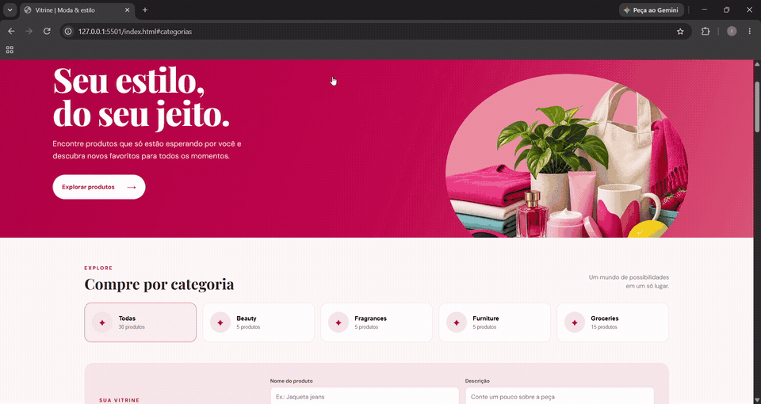

<div align="center">

# 🛍️ VITRINE | MODA & ESTILO

### Seu estilo, do seu jeito.

Uma vitrine virtual desenvolvida para apresentar produtos de forma moderna, organizada e intuitiva, permitindo explorar categorias e gerenciar produtos diretamente pela interface.


</div>

---

## 📌 Sobre o projeto

O **Vitrine | Moda & Estilo** é um projeto de desenvolvimento web que simula uma loja virtual, oferecendo uma interface para visualização e gerenciamento de produtos.

A aplicação permite explorar diferentes categorias, visualizar informações dos produtos e realizar operações de cadastro, edição e exclusão.

O objetivo foi colocar em prática conhecimentos de HTML, CSS e JavaScript, trabalhando com manipulação do DOM, eventos, funções assíncronas e integração com API externa.

## 🎥 Demonstração do projeto

<div align="center">



</div>

## ✨ Funcionalidades

- 🏠 Página inicial com apresentação da vitrine.
- 🗂️ Listagem de produtos por categoria.
- 🔎 Visualização de nome, descrição, imagem e preço.
- ➕ Cadastro de novos produtos.
- ✏️ Edição de informações dos produtos.
- 🗑️ Exclusão de produtos.
- 👋 Saudação personalizada de acordo com o nome informado.
- 📱 Layout adaptável para diferentes tamanhos de tela.
- 🔗 Integração com API externa para obtenção e gerenciamento demonstrativo dos dados.

## 🛠️ Tecnologias utilizadas

| Tecnologia | Aplicação no projeto |
|---|---|
| HTML5 | Estrutura e organização do conteúdo |
| CSS3 | Estilização e responsividade |
| JavaScript | Lógica e interatividade |
| Axios | Realização de requisições HTTP |
| DummyJSON API | Fornecimento de dados dos produtos |

## 📂 Estrutura do projeto

```text
Contrucao-de-sites-2/
│
├── .vscode/
│   └── settings.json
│
├── css/
│   ├── img/
│   └── style.css
│
├── js/
│
├── index.html
├── demo-vitrine.gif
└── README.md
```

## ⚙️ Como executar o projeto

1. Faça o download ou clone este repositório.
2. Abra a pasta do projeto no Visual Studio Code.
3. Abra o arquivo `index.html` no navegador ou utilize a extensão Live Server.
4. Informe seu nome quando solicitado.
5. Explore as categorias e funcionalidades da vitrine.

## 🌐 API utilizada

O projeto utiliza a [DummyJSON API](https://dummyjson.com/products) para obter informações dos produtos e realizar operações demonstrativas de cadastro, edição e exclusão.

**Observação:** as modificações realizadas na aplicação não são armazenadas permanentemente pela API de demonstração.

## 🎯 Objetivos de aprendizagem

Este projeto contribuiu para o desenvolvimento de conhecimentos em:

- Estruturação de páginas com HTML5.
- Estilização e responsividade com CSS3.
- Manipulação do DOM com JavaScript.
- Utilização de eventos e funções.
- Consumo de APIs externas.
- Requisições assíncronas com Axios.
- Organização de arquivos e desenvolvimento de interfaces web.

## 👥 Desenvolvedores

**Izaak**

- GitHub: [@IzaakCod](https://github.com/IzaakCod)

**Lucas**

- GitHub: [@wluckz](https://github.com/wluckz)

---

<div align="center">

### 💻 Desenvolvido com dedicação e aprendizado.

**© 2026 — Vitrine | Moda & Estilo**

</div>
